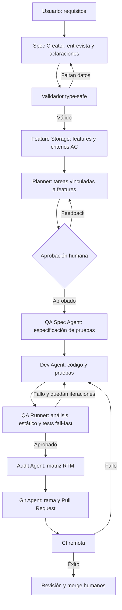

# Harness didáctico para agentes de desarrollo de software

Este repositorio describe el diseño y la evolución incremental de un sistema multiagente para apoyar el desarrollo de software. Su propósito es **didáctico**: explorar cómo dar estructura, trazabilidad y controles verificables al trabajo de agentes de IA mediante un *harness* (marco de ejecución y coordinación).

La propuesta evita tratar a los agentes como conversaciones aisladas. En su lugar, coordina su trabajo mediante estado explícito, contratos de datos, artefactos persistentes, puntos de aprobación humana y controles de calidad reproducibles.

> **Estado actual:** el repositorio contiene el descriptor de diseño y el plan por fases. La implementación del sistema todavía está por desarrollar; las tecnologías y componentes descritos son objetivos del diseño, no funcionalidades ya disponibles.

## Objetivos didácticos

- Convertir requisitos iniciales en especificaciones y *features* comprobables.
- Mantener trazabilidad desde cada *Acceptance Criterion* (AC) hasta tareas, pruebas y resultados.
- Coordinar agentes especializados con un flujo explícito y un estado compartido.
- Incorporar intervención humana antes de decisiones importantes, como aprobar el plan.
- Validar el código con controles deterministas y un ciclo de corrección limitado.
- Generar evidencia auditable y preparar la integración con Git y CI/CD.

## Flujo propuesto



## Fases de desarrollo

1. **Cimientos y persistencia:** estado compartido tipado, modelos de dominio, herramientas para consultar documentación y almacenamiento inicialmente basado en archivos Markdown.
2. **Requisitos y validación:** entrevista iterativa para aclarar requisitos, extracción de *features* y criterios de aceptación, y validación estructurada.
3. **Planificación supervisada:** generación de tareas vinculadas a sus *features* y pausa para que una persona revise o corrija el plan.
4. **Desarrollo y QA fail-fast:** generación de código y pruebas, seguido de análisis estático, pruebas unitarias y, cuando corresponda, pruebas E2E. Los fallos se devuelven al agente de desarrollo con un máximo de iteraciones.
5. **Auditoría y trazabilidad:** cruce de los resultados de pruebas con los AC y generación de una matriz de trazabilidad de requisitos (RTM).
6. **Git y CI/CD:** preparación de ramas y Pull Requests, validación remota y posible reanudación del flujo ante fallos de CI.

El detalle del diseño, las actividades y los ejemplos por fase se encuentra en [descriptor.md](descriptor.md).

## Arquitectura prevista

La estructura objetivo separa el dominio, las herramientas, los agentes y la topología del flujo:

```text
multiagent_system/
├── backlog/                 # Features persistidas inicialmente como Markdown
├── docs/                    # Documentación consultable bajo demanda
├── audit/                   # Informes de trazabilidad
└── src/
    ├── state.py             # Modelos y estado compartido
    ├── tools/               # Herramientas de Wiki, sandbox y Git
    ├── nodes/               # Lógica de los agentes
    ├── graph.py              # Definición del grafo de estados
    └── main.py               # Punto de entrada CLI/API
```

Es una estructura propuesta: puede cambiar durante la implementación. La capa de almacenamiento debe abstraerse para permitir pasar de Markdown local a otra tecnología sin acoplarla a la lógica de los agentes.

## Componentes y tecnologías contemplados

- **Python y Pydantic v2:** contratos de datos y validación de estado.
- **LangGraph:** orquestación del grafo, estado de ejecución, pausas y reanudación.
- **LangChain con proveedor LLM:** entrevistas y salidas estructuradas; el proveedor concreto queda configurable.
- **pytest y pytest-json-report:** pruebas y resultados estructurados para auditoría.
- **ruff, mypy y Bandit:** controles locales de estilo, tipado y seguridad.
- **Docker o sandbox equivalente:** aislamiento de código generado durante su ejecución.
- **GitHub CLI, GitHub Actions y FastAPI:** integración futura con Pull Requests, CI y webhooks.
- **python-dotenv:** configuración local de variables de entorno y credenciales.

Las versiones y dependencias definitivas deberán fijarse al implementar cada fase. Las claves de proveedores LLM y otros secretos no deben almacenarse en el repositorio.

## Principios de diseño

- **Estado explícito:** cada etapa consume y actualiza datos definidos, en vez de depender solo del historial conversacional.
- **Trazabilidad de extremo a extremo:** IDs como `FEAT-01`, `AC-FEAT-01-01` y `TASK-101` conectan requisitos, trabajo y evidencia.
- **Validación determinista cuando sea posible:** los tests y controles automatizados deciden los resultados de calidad; un LLM no sustituye su ejecución.
- **Human-in-the-loop:** una persona conserva la decisión sobre el plan y la publicación final.
- **Fail-fast y límites:** detener controles costosos después de un fallo y limitar los ciclos de corrección.
- **Persistencia sustituible:** separar el almacenamiento de features y documentación de la lógica del flujo.
- **Zero-trust para la ejecución:** tratar el código generado como no confiable y ejecutarlo con aislamiento, permisos mínimos y límites de recursos.

## Alcance y límites

Este proyecto es un ejercicio de diseño y aprendizaje, no una plataforma de agentes lista para producción. En particular, la ejecución de código generado, el acceso a repositorios, los webhooks y las credenciales requieren controles de seguridad, pruebas y revisión adicionales antes de cualquier uso real.

## Documento de diseño

Consulta [descriptor.md](descriptor.md) para ver la justificación, los modelos iniciales, los ejemplos de flujo y las actividades propuestas en cada fase.
